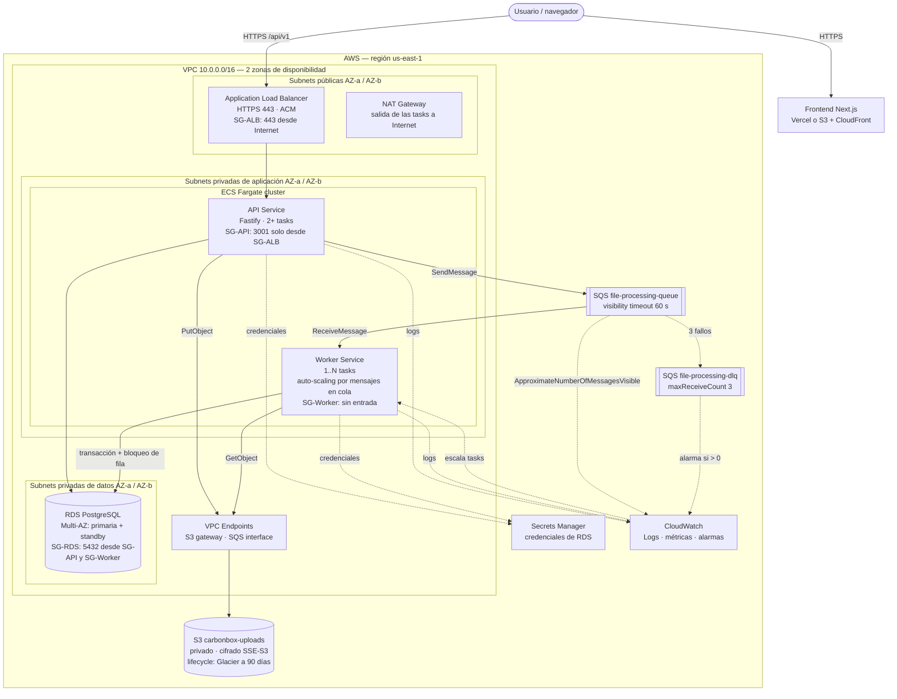

# Arquitectura en AWS

Propuesta de despliegue productivo. En local, S3 y SQS se emulan con LocalStack y PostgreSQL corre en Docker; el código es el mismo, solo cambian las variables de entorno (`AWS_ENDPOINT` vacío en AWS).

## Cómo se conectan los componentes

| Componente | Rol | Por qué así |
|------------|-----|-------------|
| **VPC con 2 AZ** | Subnets públicas (ALB, NAT), privadas de aplicación (ECS) y privadas de datos (RDS) | Nada de la aplicación ni la base es accesible desde Internet; si cae una zona, la otra sigue atendiendo. |
| **Security groups encadenados** | ALB → API (3001) → RDS (5432); el worker no acepta conexiones entrantes | Cada capa solo acepta tráfico de la capa anterior (mínimo privilegio en red). |
| **ALB** | Termina HTTPS (certificado ACM) y reparte entre tasks de la API con health check en `/health` | Las tasks de Fargate cambian de IP; el ALB las registra solas. |
| **ECS Fargate — API** | 2+ tasks en AZ distintas | Alta disponibilidad sin administrar servidores. |
| **ECS Fargate — Worker** | Misma imagen, comando `node dist/workers/index.js`; escala con la métrica de mensajes visibles en SQS | El trabajo pesado no afecta la latencia de la API, y escala con la carga real. Es seguro escalar: el worker es idempotente y usa bloqueo de fila (ver README). |
| **RDS PostgreSQL Multi-AZ** | Standby sincrónico en otra AZ con failover automático | Los uploads y sus filas no se pierden si cae una zona. |
| **S3 privado** | Guarda el CSV original; *lifecycle* a Glacier a los 90 días | El archivo queda para auditoría o reproceso sin pagar almacenamiento caliente. |
| **SQS + DLQ** | Desacopla la subida del procesamiento; tras 3 fallos el mensaje va a la DLQ | La API responde `202` al instante; los mensajes envenenados se aíslan en vez de reintentarse para siempre. |
| **VPC Endpoints** | S3 (gateway) y SQS (interface) | El tráfico a S3/SQS no sale por el NAT: más barato y no pasa por Internet. |
| **Secrets Manager** | Credenciales de RDS inyectadas como variables de entorno en la task definition | Sin secretos en el código ni en la imagen; rotación automática. |
| **IAM task roles** | API: `s3:PutObject`, `sqs:SendMessage`. Worker: `s3:GetObject`, `sqs:ReceiveMessage/DeleteMessage` | Cada servicio solo puede hacer lo que necesita. Reemplaza las claves `test/test` de LocalStack. |
| **CloudWatch** | Logs JSON de pino, métricas de ECS/RDS/SQS, alarmas (DLQ > 0, CPU, errores 5xx del ALB) | Un mensaje en la DLQ es un upload que alguien tiene que mirar. |
| **ECR** (fuera del diagrama) | Registro de la imagen construida con `backend/Dockerfile` | Una imagen, dos servicios. Las migraciones corren como task puntual (`prisma migrate deploy`) antes de desplegar. |
